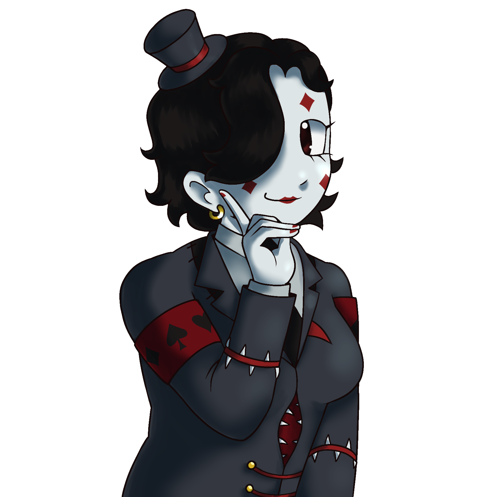
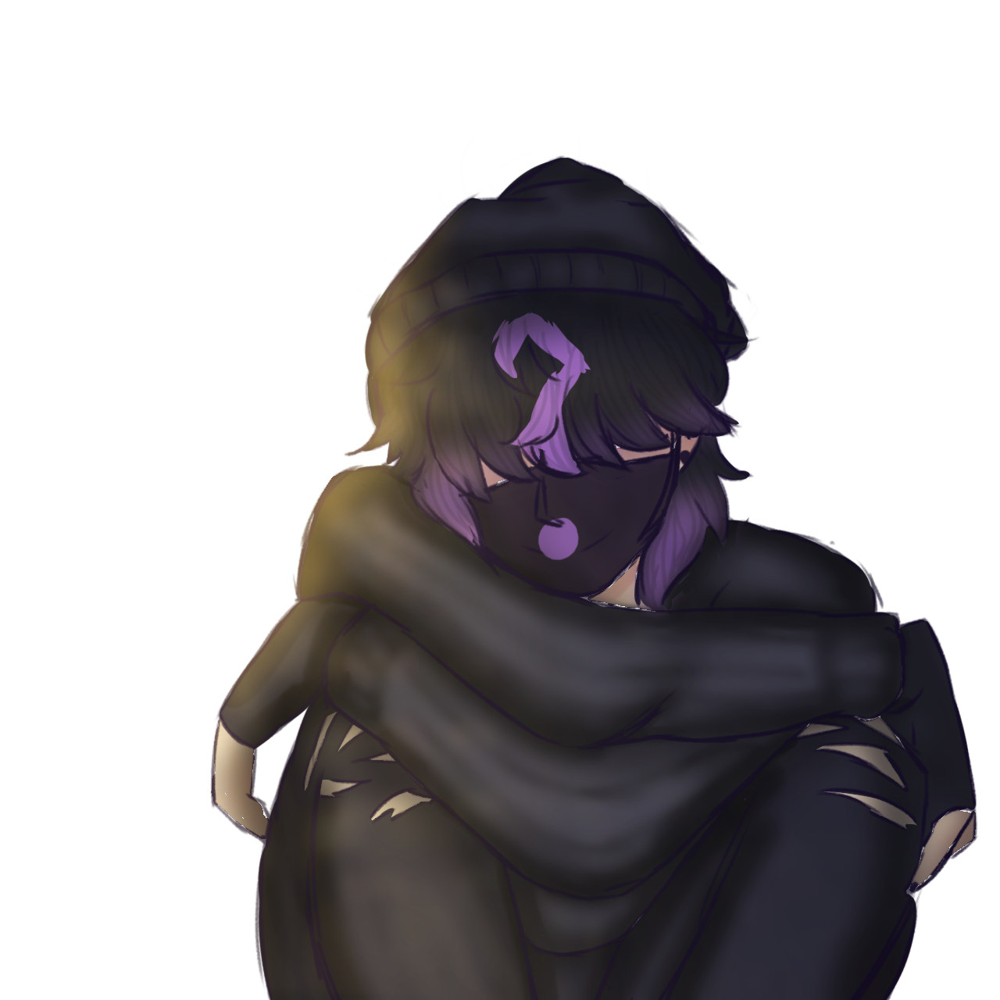
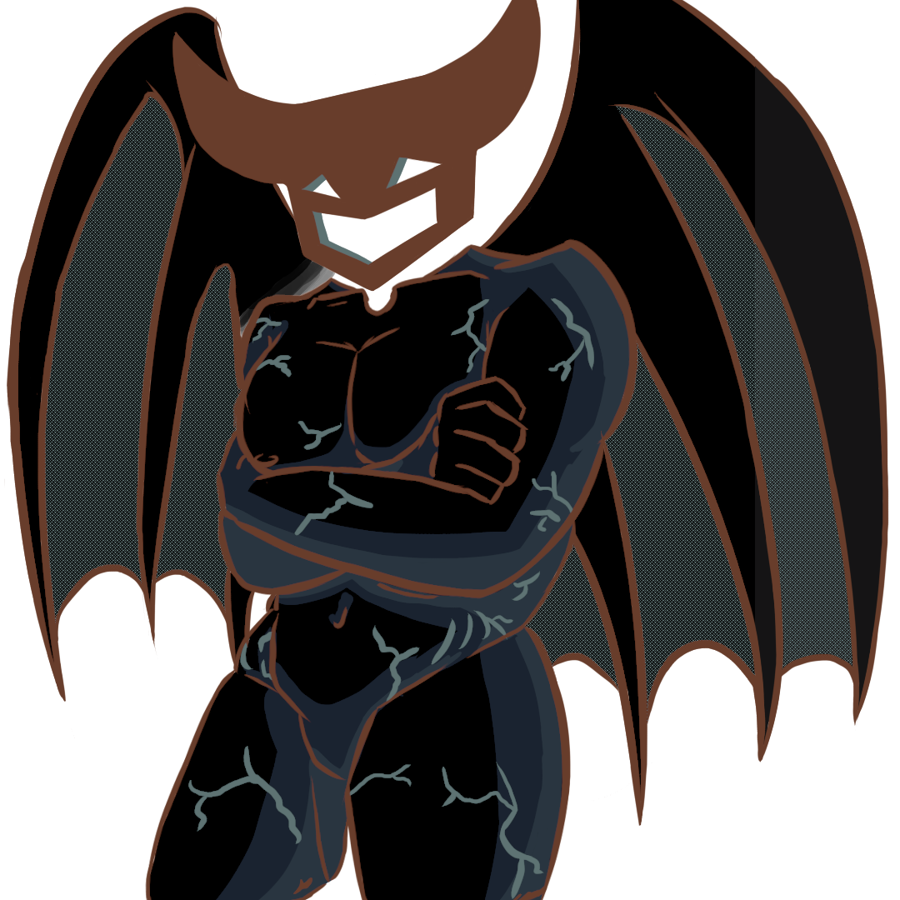

+++
date = '2026-04-04'
title = "Fantasy Island 2"
draft = false
short = '''bawoaw! an event to spread love and caring for each other. remember! sharing is caring.'''
cover = "fantasyislandcover.png"
logo = "Event-Logo.png"
authors = [
  { name = "Chaosyr", link = "https://stoatgames.icu/news/author/chaosyr/" },
  { name = "LeshyIRL", link = "https://fanscryption.com/" },
]
+++



## Fantasy Island 2 Event Details

What Exactly is Fantasy Island 2? Fantasy Island 2 in a nut shell is a Dating Simulator based on the Daniel Mullins Games Collection, e.g. Pony Island, The Hex, and Inscryption. The Chapters are as follows:

| Chapter 1                             | Chapter 2                             | Chapter 3                             |
| :-----------------------------------: | :-----------------------------------: | :-----------------------------------: |
|  |  |  |
| Click the Card to go to Chapter 1     | Click the Card to go to Chapter 2     | Click the Card to go to Chapter 3     |

### Chapter 1

P03 in this light is cast as a Student at **Daniel Mullins University** who is a member of a Club entitled “The Better Inscryption Club”. Oh yeah, P03 also made a 10k word fan fiction of P03 X Leshy with the genre of Hurt/Comfort.

Timestamps in the VOD: `24:03 - 38:07`

### Chapter 2

Sado is portrayed as a lovely woman you met online going by the screen name of **CoulromanticDame51**. With a peculiar interest in **Game Exploits** as well as **Spiders** and **Clowns**. She is also portrayed as someone in which the audience and player is speaking to online through a classic Web-Messenger.

Click to Show Spoilers

First Person Perspective is portrayed as the "FirstPurpleProtagonist" who stares at you without a voice of their own. They communicate through text on the screen. They are also self-concious about their role in the story, that being they are a vassel for others usage.

Timestamps in the VOD: `40:12 - 1:02:12`

### Chapter 3

Lou Natas is portrayed as the CEO of the Prestigious, Award-Winning Game Studio "Big GamFunni". The studio itself has confusing halls and inconsistent hours, with rather odd employees as well. Lou Natas is described as Eccentric, oh also neat little fun fact he likes the Souls of the Damned with his coffee. The player is his personal assistant. The thing that may feel like a memorable aspect about him is that he bears a deep southern accent, or perhaps the fact his chest is exposed?

Timestamps in the VOD: `1:02:13 - 1:14:53`

## Closing thoughts

Maybe we will see a full Fantasy Island 2 game someday, but for you eager lovers out there, you’ll just have to sit tight and wait! 
